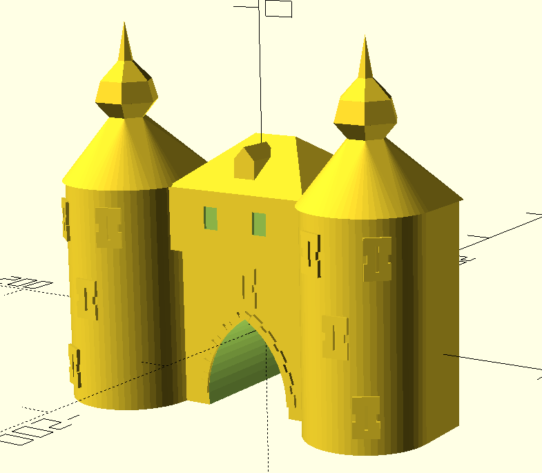

# CLAUDE.md — KI-Workshop 2 Präsentation

## Projektübersicht

Quarto Reveal.js-Präsentation für den **KI-Workshop 2** des Erfindergeist Jülich e.V.
Ziel: Teilnehmer ohne Vorwissen von den KI-Grundlagen bis zum **3D-druckbaren Objekt** führen.
Roter Faden: verstehen → richtig fragen → Werkzeuge kennen → etwas Echtes bauen (Details: `roter_faden.md`, offene Punkte: `todo.md`).

Die Präsentation deckt folgende Themen ab (Reihenfolge):
1. Vorstellung Erfindergeist Jülich e.V. (inkl. Offene Werkstatt / 3D-Druck)
2. Was ist KI? / Was ist sie nicht? (inkl. Aufbau eines Modells und Parameter)
3. Prompting (SAND-Methode, Token, Kontextfenster, Grenzen der Antworten)
4. Eingabemöglichkeiten: Web-UI, CLI-Agenten, IDE, lokal vs. Cloud, Workstation-Hardware
5. 3D-Generierung (Hauptteil): Weg 1 Bild → 3D (ComfyUI + Hunyuan3D lokal, HuggingFace), Weg 2 Text → Code → 3D (OpenSCAD)
6. Vom Modell zum Druck
7. Zusammenfassung, Fragen & Diskussion
8. Bonus: HuggingFace, Termine-Webseite
9. Referenzen, Spenden, Ende

## Dateien

| Datei | Zweck |
|---|---|
| `ki2.qmd` | **Haupt-Präsentation** — alle Folien hier |
| `styles.css` | Custom CSS für Reveal.js (nicht in `_brand.yml` abbildbar) |
| `_brand.yml` | Farb- und Typografie-Definitionen |
| `_quarto.yml` | Projekt- und Format-Konfiguration |
| `beispiele/<name>/` | **Alles zu einem Beispiel** in einem Ordner: Bilder, `.scad`, Prompt, Demo-HTML + `README.md` (z.B. `hexenturm/`, `tischfuss/`, `muttkrat/`) |
| `grafiken/` | Erklär-Grafiken als SVG (neuronales Netz, MCP, VRAM, Weg-1-Prinzip) |
| `handouts/` | Druckvorlagen für den Workshop-Tag als `.md` → PDF (A4): Prompt-Beispiele (neben den KI-Rechner legen), QR-Aushang zur Präsentation (`qr-praesentation.md`) |
| `verein/` | Logo, Linktree-QR, Werkstatt-Foto |
| `qr-codes/` | Erzeugte QR-Codes (siehe Abschnitt QR-Codes) |
| `qrcodes.sh` / `compose.yaml` | QR-Code-Erzeugung per Podman (siehe Abschnitt QR-Codes) |

## CI / Design-Vorgaben

Farben aus `_brand.yml` — niemals davon abweichen:

| Name | Hex | Verwendung |
|---|---|---|
| `mint` | `#159989` | Primary, H1-Unterstrich, Bullets, Code-Blöcke-Border, Fortschrittsbalken |
| `amber` | `#F9B338` | Secondary, `**fett**`, `code`, Links, OL-Marker |
| `dark-grey` | `#222222` | Hintergrund |
| `dark-medium` | `#2d2d2d` | Code-Block-Hintergrund, Tabellen-Zebrastreifen |
| `white` | `#ffffff` | Fließtext |
| `light-grey` | `#aaaaaa` | Subtitle, dezente Elemente |

**Keine Google Fonts** — DSGVO-Vorgabe. Keine externen Font-CDNs einbinden.

## Quarto Reveal.js — Wichtige Konventionen

### Titelfolie

Die erste Folie ist **keine normale Folie im Text**, sondern wird aus dem YAML-Kopf von `ki2.qmd` erzeugt:

```yaml
title: KI to 3D
title-slide-attributes:                    # Hintergrund nur für die Titelfolie
  data-background-image: verein/logo.svg
  data-background-size: 40%
  data-background-opacity: "0.15"          # Logo als dezentes Wasserzeichen
subtitle: Mit KI zum eigenen 3D-Druck · 21.11.2026   # Untertitel wie auf dem Plakat + Workshop-Termin
```

Änderungen an Titel oder Datum also immer dort vornehmen. **Zwischen YAML-Kopf und der ersten `#`-Überschrift darf nichts stehen** — auch keine HTML-Kommentare, sonst entsteht eine leere Folie 2. Der Titel steht zusätzlich im `footer` und in `_quarto.yml` (Website-Titel).

### Folientypen

```markdown
# Abschnittstitel          ← Neue Section (große Titelfolie)
## Unterfolie              ← Normale Inhaltsfolie innerhalb der Section
```

Navigation ist **vertikal** (`navigation-mode: vertical`) — `#` wechselt horizontal, `##` vertikal.

**Folientitel:** Jede `##`-Folie beginnt mit dem Kurznamen ihrer Section (`Erfindergeist:`, `KI:`, `Prompting:`, `Eingabe:`, `3D:`, `Weg 1:`, `Weg 2:`, `Weg 3:`, `Zusammenfassung:`, `HuggingFace:`, `Webseite:`, `Tipp:`, `Referenzen:`). Titel **einzeilig** halten (max. ca. 34 Zeichen). Mehrteilige Folien mit `(1/2)` / `(2/2)`.

**Achtung:** Auf `#`-Folien keine `###`-Überschriften verwenden (auch nicht in Spalten) — Pandoc beendet die Folie sonst vorzeitig und der restliche Inhalt hängt außerhalb jeder Folie. Inhalte mit Zwischenüberschriften immer auf eine `##`-Folie legen.

### Spalten-Layout

```markdown
::: columns
::: {.column width="60%"}
Inhalt links
:::
::: {.column width="40%"}
Inhalt rechts
:::
:::
```

Spalten-Breiten immer explizit angeben und auf 100 % addieren.

### Bilder

```markdown
{fig-align="center" height="500"}
```

**Bildunterschrift** als Alt-Text in die eckigen Klammern schreiben (``) — wird per `styles.css` zentriert, grau und klein unter dem Bild gesetzt. Keine separate `[…]{style=…}`-Zeile dafür.

**`height="500"` ist der Standard für Vollbild-Bilder** — so bleibt das Bild im Bildschirm.
Breiten-Prozent (`width="100%"`) nur in Spalten-Layouts.

**Dateinamen:** sprechend und mit dem Beispielnamen vorne (`hexenturm_gedruckt.jpg`, nicht `IMG_123.jpg`) — die Teilnehmer suchen die Dateien auf GitHub.

**Kein `.webp`** — der PDF-Export (LaTeX) in der Pipeline kann WebP nicht einbinden. Fotos als `.jpg`, Screenshots als `.png`, Grafiken als `.svg`.

### Fußnoten / Quellenangaben

```markdown
::: aside
Quellenangabe oder Fußnote hier.
:::
```

### Speaker Notes

```markdown
::: {.notes}
Sprechernotizen hier — nicht auf der Folie sichtbar.
:::
```

### Tabellen

```markdown
| Spalte A | Spalte B |
|---|---|
| Wert | Wert |

: {tbl-colwidths="[30,70]"}
```

`tbl-colwidths` immer angeben, damit Tabellen nicht überlaufen.

Einheitliches Tabellen-Design kommt aus `styles.css`: volle Breite, Kopfzeile Mint mit dunklem Text (auch bei `**fett**` im Kopf), Zebrastreifen. Kein `{.smaller}` auf Tabellenfolien — passt eine Tabelle nicht, auf zwei Folien `(1/2)` / `(2/2)` mit gleicher Kopfzeile aufteilen.

## Kritische Regel: Kein Text außerhalb des Bildschirms

**Das ist das häufigste Problem — immer zuerst prüfen.**

Checkliste für jede neue Folie:
- Bullet-Listen: maximal **5–6 Punkte** pro Folie, sonst aufteilen
- Langer Fließtext: in Bullets umwandeln oder auf mehrere Folien verteilen
- Bilder mit `height` begrenzen: `height="500"` für große, `height="350"` in Spalten-Layouts
- Code-Blöcke: nur kurze Snippets direkt auf Folie; lange Beispiele → Datei + `code-link`
- Tabellen mit vielen Spalten: Spaltenbreiten mit `tbl-colwidths` kontrollieren
- Bei Spalten-Layouts: Inhalte jeder Spalte einzeln auf Überlauf prüfen
- `font-size: smaller` als CSS-Klasse nutzen wenn nötig: `[Text]{style="font-size:0.75em"}`

Wenn eine Folie zu voll wird: **aufteilen**, nicht verkleinern. Lieber eine Folie mehr.

## Hilfsklassen (styles.css)

```markdown
[Chip-Text]{.token-chip}   ← Gelber Chip im Monospace-Stil (z.B. für Token-Beispiele)
::: {.plain-table}          ← Tabelle ohne Rahmen/Zebra, 1. Buchstabe der 1. Spalte in Mint
::: {.prompt-box}           ← Prompt-Darstellung: dunkle Box mit Mint-Rand (.prompt-weak = grauer Rand)
[S]{.sand-letter}           ← Buchstabe im Mint-Kreis (z.B. für SAND-Beispiel)
::: {.chat-input}           ← Text als Chat-Eingabefeld (abgerundet, Mint-Senden-Button)
::: {.card}                 ← Karte: dunkle Box mit Mint-Rand oben, letzte Zeile in Mint (z.B. Problem → Lösung)
::: {.card .qr}             ← QR-Karte: zentriert, QR-Code mit weißem Rahmen, Link in Mint (Folie „Erfindergeist: Wichtige Links“)
::: {.spend-grid}           ← 2×2-Raster aus kleinen Karten (Folie „Erfindergeist: Spenden“, am Anfang und identisch am Ende); [Text]{.spend-thanks} = zentrierte Dankeszeile in Mint
::: {.link-grid}            ← 3-spaltiges Raster aus Link-Karten (Folie „Prompting: Beispiele im Web“); {.link-grid .two} = 2 Spalten
[Text]{.rtfm}               ← schräger Stempel in Amber (z.B. „RTFM“, „Abgucken erlaubt!“)
::: {.takeaways}            ← 3-spaltiges Raster mit automatisch nummerierten Karten (Folie „Zusammenfassung: Zum Mitnehmen“)
::: {.ctx-grid}             ← 3 Karten als Treppe, wachsen von links nach rechts (Folie „Prompting: Kontextfenster-Größe“); [Text]{.ctx-seiten} = größere Mittelzeile, letzte Zeile grau
::: {.weg-grid}             ← 3 zentrierte Karten mit Vorschaubild (Folie „3D: Drei Wege zum Modell“); [Weg 1]{.weg-nr} = Label, {.card .ausblick} = gestrichelter Rand
```

## HTML-Demo-Folien

Interaktive Demos werden als **eigenstandige HTML-Dateien** im Root abgelegt (z.B. `beispiele/herzanimation/herzanimation.html`).
Quarto kopiert sie automatisch nach `_site/` - keine Quarto-Konfiguration notig.

JavaScript-Bibliotheken (GSAP etc.) mussen **lokal** unter `js/` liegen - nicht von externen CDNs laden,
da die Prasentation stand-alone funktionieren muss.

Einbindung in eine Folie via iframe:

```markdown
## Titel {background-color="#222222"}

```{=html}
<iframe src="beispiele/<name>/<name>.html"
  style="width:100%;height:85vh;border:none;background:#222222;">
</iframe>
```
```

Regeln:

- `background-color` auf der Folie immer mit dem Demo-Hintergrund abstimmen (`#222222` fur Dark)
- Kein erklarender Text in der HTML-Datei - Erklarung auf Vor- oder Nachfolgefolie
- GSAP laden via `<script src="js/gsap.min.js"></script>`

Bestehende Demos:

| Datei | Inhalt |
| --- | --- |
| `beispiele/herzanimation/herzanimation.html` | GSAP-Pulsanimation: Kreis (alt) vs. Herzform (neu) |
| `beispiele/snake/snake.html` | KI-generiertes Snake-Spiel (eigener Hintergrund `#2c3e50`) |

## QR-Codes

QR-Codes werden **nicht** über externe Dienste erzeugt, sondern lokal per Podman:

```bash
podman compose run --rm qrcode
```

- `compose.yaml` startet einen Node-Container, installiert `qrcode` und führt `qrcodes.sh` aus
- Neue Links in der Liste am Ende von `qrcodes.sh` ergänzen: `<name> <url ohne https://>`
- Ausgabe: `qr-codes/<name>.png` (PNG, 2000 px, Fehlerkorrektur H)
- Einbinden z.B. mit `{height="250"}`

## Diagramme

- `beispiele/bildverarbeitung-diagramm/diagramme.py` erzeugt die Ablaufdiagramme (Folie „Tipp: Vorher und Nachher“) als SVG in CI-Farben — ohne externe Tools
- Aufruf: `python3 beispiele/bildverarbeitung-diagramm/diagramme.py` → `beispiele/bildverarbeitung-diagramm/*.svg`
- Knoten und Pfeile werden im Skript mit Raster-Koordinaten gesetzt (`node(...)`, `edge(...)`)

## Plakat (A3 / A4 / A5) und Flyer (A5)

- `drucksachen/plakat.html` — Werbeplakat, eigenständige HTML-Datei, **alle Maße in mm** (`@page { size: A3 }`)
- A4 und A5 sind **kein eigenes Layout**: `plakat.html?a4` bzw. `?a5` verkleinert per CSS `zoom` (1/√2 bzw. 50 %) und setzt `@page` passend — nur `plakat.html` bearbeiten
- Flyer (A5, doppelseitig): Vorderseite = `plakat.html?a5`, Rückseite = `drucksachen/rueckseite.html` (eigenes Layout, Maße in mm für A5)
- `drucksachen/pdf.sh` — exportiert per Headless-Chrome nach `drucksachen/plakat-a3.pdf`, `plakat-a4.pdf`, `plakat-a5.pdf` und erzeugt den Flyer als Einzelseiten (`flyer-a5-vorderseite.pdf`, `flyer-a5-rueckseite.pdf`, für die Druckerei) sowie per `pdfunite` zweiseitig (`flyer-a5.pdf`)
- Bilder relativ einbinden (`../beispiele/…`, `../verein/…`); Farben als CSS-Variablen (CI-Farben)
- Schriften: Rubik (Überschriften) + Inter (Text) per Google-Fonts-Link — **Ausnahme von der DSGVO-Regel**, weil das Plakat nur als PDF verteilt wird (Schriften eingebettet), nicht als Webseite. In der Präsentation bleiben Google Fonts verboten.
- Pipeline (`deploy.yml`): erzeugt die PDFs nach dem Quarto-Render und kopiert sie nach `_site/drucksachen/` → online unter `/ki2/drucksachen/plakat-a3.pdf`, `…/plakat-a4.pdf`, `…/plakat-a5.pdf`, `…/flyer-a5.pdf`, `…/flyer-a5-vorderseite.pdf` und `…/flyer-a5-rueckseite.pdf`

## Build

```bash
quarto render ki2.qmd
quarto preview ki2.qmd    # Live-Vorschau mit Auto-Reload
```

Output landet in `_site/`.

## Inhaltliche Leitlinien beim Erweitern

- **Sprache**: Deutsch, in Folien und Handouts **Du-Form** (Workshop-Atmosphäre im Verein). Die Sie-Form nur in Anschreiben an Unternehmen (z.B. Mails an große Firmen)
- **Ton**: sachlich-informativ, kein Marketing-Sprech, keine Übertreibungen
- **Tiefe**: Einsteiger-freundlich — technische Begriffe immer kurz erklären
- **Struktur**: Jede neue Demo oder jedes Tool bekommt eine Section (`#`) und mindestens eine Unterfolie (`##`)
- **Quellen**: Externe Links immer mit Datum-Hinweis versehen (Preise / Specs ändern sich)
- **TODOs**: Unfertige Folien mit `<!-- TODO: ... -->` markieren, nicht leer lassen
