<!-- Die Präsentation ist Online unter https://presentations.erfindergeist.org/ki2/ zu finden -->

<!-- Der Veranstalter: Erfindergeist Jülich e.V. stellt sich kurz vor -->
# Vorstellung Erfindergeist Jülich e.V

* Gemeinnütziger Verein mit Sitz in Jülich, gegründet 2021
* **Ziel**: Förderung von Kreativität und Innovation durch praktisches Lernen und Zusammenarbeit
* Angebote
  * Offene Werkstatt (3D-Drucker, CNC, Holz-, Metall-, Elektroarbeiten, IT, etc.)
  * Wissensvermittlung 
  * Repair Café
  

::: {.notes}
Kurz den Verein vorstellen. Hinweis auf die Offene Werkstatt – der 3D-Drucker ist später der rote Faden des Workshops.
:::


## Offene Werkstatt: 3D-Druck 1/2

::: columns
::: {.column width="55%"}
- 3D-Drucker baut Objekte **Schicht für Schicht** aus Kunststoff
- Ideal für Ersatzteile, Prototypen, Halterungen, Modelle
- Bei uns: **Prusa CORE One+** in der Offenen Werkstatt
:::
::: {.column width="45%"}
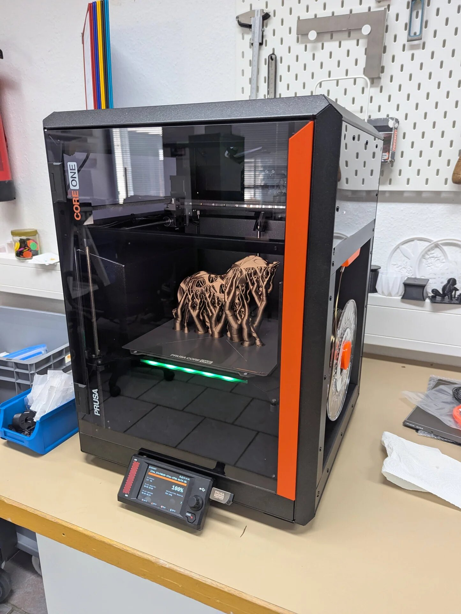{fig-align="center" height="500"}
:::
:::

::: {.notes}
Das Foto zeigt den Prusa CORE One+ der Offenen Werkstatt (Bauraum 250 × 220 × 270 mm). Frage ans Publikum: Wer hat schon einmal etwas 3D-gedruckt?
:::

## Offene Werkstatt: 3D-Druck 2/2

Wo bekommt man 3D-Modelle her?

- CAD - Selber Herstellen oder Kaufen
- Kostenlose Modelle: [https://www.thingiverse.com/](https://www.thingiverse.com/) oder [https://www.printables.com/](https://www.printables.com/)
- KI durch Text oder Bilder

## Offene Werkstatt: KI-Workstation

- Eigener KI-Rechner in der Werkstatt — alles läuft **lokal**
- Grafikkarte: RTX 5060 Ti mit **16 GB** Grafikspeicher
- Chatten (Open WebUI), Programmieren (OpenCode), Bilder und 3D (ComfyUI)
- Im Netzwerk der Werkstatt auch vom eigenen Laptop nutzbar
- PrusaSlicer ist installiert und mit dem 3D-Drucker verbunden

::: aside
Anleitungen im Wiki: [docs.erfindergeist.org › Workstation](https://docs.erfindergeist.org/s/wiki/doc/workstation-kcLc2sv1PX)
:::

::: {.notes}
Die Workstation ist der rote Faden für alle Live-Demos heute: Chat, Coding und 3D-Generierung laufen auf diesem Rechner, ohne Cloud.

Weitere Daten: Intel i3-13100F, 16 GB Arbeitsspeicher, Betriebssystem NixOS. Für KI zählt vor allem die Grafikkarte – die 16 GB Grafikspeicher bestimmen, wie große Modelle laufen (dazu mehr in der Section Token).
:::


## Spenden


::: columns
::: {.column width="70%"}

- Erfindergeist Jülich e.V. finanziert sich ausschließlich durch Mitgliedsbeiträge und Spenden. Wir Danken allen Unterstützern, die unsere Arbeit ermöglichen!

- Spenden Konto und PayPal auf unserer Webseite [https://linktree.erfindergeist.org/](https://linktree.erfindergeist.org/)

:::
::: {.column width="30%"}

{width="100%"}

:::
:::

::: {.notes}
Kurz auf Spendenmöglichkeiten hinweisen – nicht zu lange verweilen, am Ende kommt die Folie noch einmal.
:::

# Was ist KI?

## Was ist KI? Einfach erklärt

**KI ist ein Programm, das aus Beispielen lernt — statt feste Regeln zu befolgen.**

::: columns
::: {.column width="50%"}
### Normales Programm

Statisch immer gleiches Ergebnis
Ein Mensch schreibt die Regel:
*„Spitze Ohren + Schnurrhaare = Katze“*


:::
::: {.column width="50%"}
### KI

Sieht tausende Katzenfotos — und findet die Regel wahrscheinlich **selbst**.
kann aber auch fehlerhaft sein.

:::
:::

::: {.fragment}
Wie ein Kind: Niemand erklärt ihm, was eine Katze ist. Es hat einfach viele gesehen.
:::

::: {.notes}
Einstieg ohne Fachbegriffe. Frage ans Publikum: Wie würden Sie einem Computer erklären, was eine Katze ist? Schnell merkt man: Regeln reichen nicht (es gibt Katzen ohne sichtbare Ohren, Hunde mit spitzen Ohren …).

KI begegnet uns längst im Alltag: Gesichtserkennung am Handy, Spamfilter im E-Mail-Postfach, Stauprognose im Navi.

KI ist ein Oberbegriff. Sprachmodelle (LLMs) wie ChatGPT sind nur ein Teil davon – aber der Teil, um den es heute hauptsächlich geht.
:::

## Wie ist ein KI-Modell aufgebaut?

::: columns
::: {.column width="50%"}
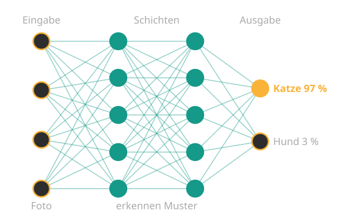{fig-align="center" width="100%"}
:::
::: {.column width="50%"}
- **Eingabe:** Foto, Text oder Ton — als Zahlen
- **Schichten** aus künstlichen „Nervenzellen“
- Jede Verbindung hat einen **Regler**: Wie wichtig ist dieses Signal?
- **Ausgabe:** Wahrscheinlichkeit, z.B. *Katze 97 %*
:::
:::

::: {.notes}
Das Vorbild ist grob das Gehirn: Nervenzellen, die über Verbindungen Signale weitergeben. Man nennt das „neuronales Netz“.

Die ersten Schichten erkennen einfache Dinge wie Kanten und Farben. Spätere Schichten setzen daraus größere Muster zusammen: Ohren, Augen, Fell – und am Ende „Katze“.

Training an Beispielen: Die KI rät, vergleicht mit der richtigen Antwort und dreht die Regler ein kleines Stück in die richtige Richtung. Das passiert millionenfach.

Ein Sprachmodell wie ChatGPT funktioniert nach demselben Prinzip – nur ist die Eingabe Text und die Ausgabe das wahrscheinlichste nächste Wort. Die Regler tauchen später als „Parameter“ wieder auf.
:::

## Was sind LLM

**Large Language Models (LLM)** sind KI-Modelle, die auf riesigen Textmengen trainiert wurden. Sie verstehen und erzeugen Sprache, beantworten Fragen und helfen bei der Analyse von Informationen.

Beispiel: ChatGPT, Claude, Copilot, Qwen, Gemini, Deepseek

Zu beachten ist das Dienste wie ChatGPT, Copilot oder Gemini auf LLMs basieren, aber nicht die LLMs selbst sind. Sie sind Anwendungen, die auf den Modellen aufbauen.

::: {.notes}
Wichtig ist die Unterscheidung Modell vs. Anwendung: ChatGPT ist die Anwendung, GPT das Modell dahinter. Das wird später bei den Eingabemöglichkeiten wieder wichtig.
:::

## Arten von LLMs

::: columns
::: {.column width="50%"}
### Text-Modelle

- Eingabe: nur Text
- Ausgabe: Text
- z.B. Llama 3, DeepSeek-R1
:::
::: {.column width="50%"}
### Multimodale Modelle

- Eingabe: Text, **Bilder**, teils Audio
- „Sehen“ Fotos, Screenshots, Diagramme, Handschrift
- z.B. GPT, Claude, Gemini, Gemma 3
:::
:::

::: aside
Multimodal = mehrere Modalitäten, also Arten von Eingaben wie Text, Bild oder Ton.
:::

::: {.notes}
Multimodale Modelle verarbeiten Bilder selbst: Ein Bild wird in kleine Bildausschnitte zerlegt und in Token umgewandelt – ähnlich wie Text. Dafür ist kein externes Werkzeug wie Texterkennung (OCR) nötig. Bilder verbrauchen dabei ebenfalls Token im Kontextfenster.

Text-Modelle können mit einem Bild nichts anfangen. Viele Modelle gibt es in beiden Varianten, z.B. Qwen (Text) und Qwen-VL (Vision-Language).
:::


## Beispiel: Multimodale Modelle

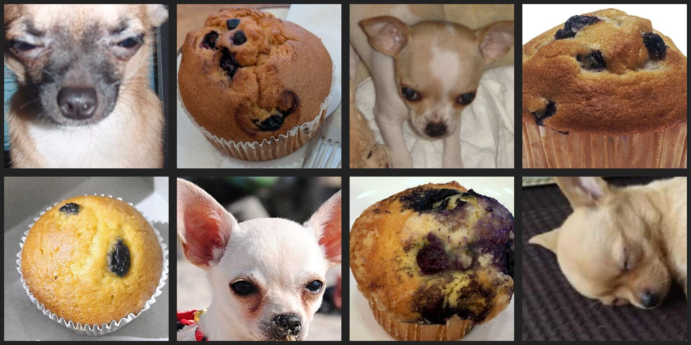{fig-align="center" height="420"}

Chihuahua oder Muffin? Bild hochladen und die KI fragen.

::: {.notes}
Live-Demo: Bild in ein multimodales Modell hochladen (z.B. Gemma 3 in Open WebUI oder ChatGPT) und fragen: „Welche Bilder zeigen einen Hund, welche einen Muffin?“

Auflösung (Reihe für Reihe, von links): Hund, Muffin, Hund, Muffin – Muffin, Hund, Muffin, Hund.
:::

## Ergebnis: Chihuahua Muffin

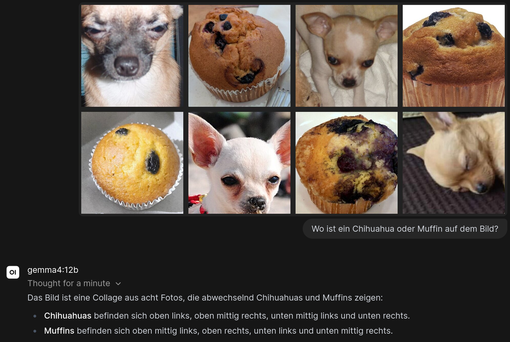{fig-align="center" height="520"}

::: {.notes}
Ergebnis des lokalen Modells besprechen: Was wurde richtig erkannt, wo lag es daneben?
:::

## Spezielle Coding-LLMs

Sprachmodelle, die besonders viel **Programmcode** gelernt haben.

- Schreiben und erklären Code
- Vervollständigen Code beim Tippen
- Können Programme selbst testen und Fehler beheben

**Beispiele:** Claude Code, GitHub Copilot, Qwen-Coder, DeepSeek, Kimi K3


::: {.notes}
Coding-Modelle sind normale LLMs, die zusätzlich mit großen Mengen Quellcode trainiert wurden. Dadurch beherrschen sie Syntax und typische Muster vieler Sprachen besser.

„Ergänzen mitten in einer Datei“ (Fill-in-the-Middle): Das Modell sieht Code vor und nach der Cursorposition und füllt die Lücke – die Grundlage für Autovervollständigung im Editor.

Werkzeuge: Moderne Coding-Modelle sind darauf trainiert, selbstständig Dateien zu lesen, zu bearbeiten und Befehle (z.B. Tests) auszuführen. Das nutzen Coding-Agenten wie OpenCode oder Claude Code – dazu später mehr.

Große Allround-Modelle wie Claude oder GPT sind ebenfalls sehr gut im Programmieren. Spezielle Coding-Modelle lohnen sich vor allem lokal, weil ein kleineres Spezialmodell auf eigener Hardware läuft und beim Code trotzdem gute Ergebnisse liefert.
:::

## Andere Arten von KI

- **Bildgenerierung** (Bild Generation): KI erzeugt Bilder aus Textbeschreibungen, z.B. für Kunst, Werbung oder Design. 
- **Spracherkennung (Speech Recognition):** KI wandelt gesprochene Sprache in Text um, z.B. für virtuelle Assistenten oder Transkriptionen.

- **Informationsextraktion (Information Extraction):** KI analysiert Texte, um relevante Informationen zu extrahieren, z.B. für Datenbanken oder Zusammenfassungen. 

::: {.notes}
Nicht jede KI ist ein Sprachmodell. Viele Anwendungen im Alltag (Gesichtserkennung im Handy, Diktierfunktion) nutzen spezialisierte Modelle.
:::

## Was ist KI?: Was ist KI nicht

**Experiment** auf [chatgpt.com](https://chatgpt.com/):

::: {.chat-input}
Nenne mir eine zufällige Zahl.
:::

::: {.fragment}
KI ist **kein Zufallsgenerator**: Sie sagt das **wahrscheinlichste** nächste Wort voraus. Meistens 73, weil diese Zahl in den Trainingsdaten oft vorkommt.
:::

::: {.notes}
KI generiert Antworten, indem sie die wahrscheinlichsten nächsten Wörter vorhersagt – basierend auf den Mustern aus den Trainingsdaten. Die Antwort ist daher nicht wirklich zufällig, sondern eine Zahl, die in den Trainingsdaten häufig vorkommt oder als wahrscheinlich gilt. Es könnte z.B. sein, dass die Zahl 73 oft in den Daten vorkommt.

Tipp: Mehrere Teilnehmer gleichzeitig fragen lassen und die Antworten vergleichen.
:::

# Token

Wie die KI Text liest — und was sie dafür an Hardware braucht.

<!-- Ziel ist es aufzuzeigen wo die unterscheide zwischen Tokens in der Cloud und Lokal liegen. Am ende muss jeder Teilnehmer die Unterschiede verstehen. Die Tiefe sollte sich auf Parameter und Präzision beschränken-->

::: {.notes}
Ziel der Section: verstehen, wie die KI Text „sieht“, und warum lokale Modelle kleiner sind als Cloud-Modelle.
:::

## Token: KI liest in Puzzleteilen

Die KI zerlegt jeden Text in kleine Stücke — **Token**.

| Text | Token | Anzahl |
|---|---|---|
| Hallo Welt! | [Hallo]{.token-chip} [␣Welt]{.token-chip} [!]{.token-chip} | 3 |
| Apfel | [Apfel]{.token-chip} | 1 |
| Verständnisfragen | [Verständ]{.token-chip} [nis]{.token-chip} [fragen]{.token-chip} | mehrere |

: {tbl-colwidths="[30,55,15]"}

**Faustregel:** 100 Token ≈ 75 Wörter

::: aside
Selbst ausprobieren: [platform.openai.com/tokenizer](https://platform.openai.com/tokenizer)
:::

::: {.notes}
Häufige, kurze Wörter sind meist ein einzelnes Token. Lange oder seltene Wörter werden in mehrere Stücke zerlegt. Die Aufteilung bei „Verständnisfragen“ ist vereinfacht dargestellt.

Das Leerzeichen (␣) gehört meist zum nächsten Wort und ist kein eigenes Token.

Live: Den Tokenizer öffnen und einen deutschen und einen englischen Satz vergleichen – deutsche Texte brauchen oft mehr Token.
:::

## Token: Was sind Parameter?

Stellen Sie sich ein **riesiges Mischpult** vor:

- Jeder Drehregler ist ein **Parameter**
- Beim Training werden alle Regler eingestellt — dort steckt das Gelernte
- **7B** = 7 Milliarden Regler (B = englisch *billion*, Milliarde)
- Mehr Regler = mehr Wissen und Können

::: {.fragment}
Jede Reglerstellung muss gespeichert werden — darum braucht KI so viel **Arbeitsspeicher**.
:::

::: {.notes}
Bezug zur Katze von vorhin: Die KI hat aus vielen Katzenfotos gelernt. Wo steckt dieses Wissen? In der Stellung der Regler. Beim Training wird jeder Regler ein kleines Stück gedreht, bis die Antworten stimmen.

Ein einzelner Regler bedeutet nichts. Erst alle zusammen ergeben das „Wissen“ des Modells – ähnlich wie ein einzelner Pixel noch kein Bild ist.

Technisch ist jeder Regler eine Zahl.
:::

## Token: Wie schnell schreibt die KI?

**Tokens pro Sekunde** = die Schreibgeschwindigkeit der KI

<!-- TODO: Werte auf der Workstation messen: ollama run qwen3.5:9b --verbose bzw. qwen2.5-coder:14b --verbose ("eval rate") und Schätzwerte ersetzen -->

::: columns
::: {.column width="33%"}
::: {.card}
**Mensch liest**

5–10 Token pro Sekunde

Maßstab
:::
:::
::: {.column width="34%"}
::: {.card}
**Workstation: 9B-Modell**

ca. 45–55 Token pro Sekunde

flüssig
:::
:::
::: {.column width="33%"}
::: {.card}
**Workstation: 14B-Modell**

ca. 30–35 Token pro Sekunde

flüssig
:::
:::
:::

::: aside
Geschätzt für unsere Workstation (RTX 5060 Ti, 16 GB) mit Ollama, Stand: Oktober 2026 — abhängig von Modell, Version und Einstellungen.
:::

::: {.notes}
Alles, was schneller ist als wir lesen, wirkt flüssig. Größere Modelle sind langsamer, weil mehr Regler berechnet werden müssen.

Die Werte sind eine Schätzung: Die Geschwindigkeit hängt vor allem davon ab, wie schnell die Grafikkarte ihren Speicher lesen kann (bei der RTX 5060 Ti rund 448 GB/s). Pro Token muss das ganze Modell einmal gelesen werden – ein 9B-Modell (ca. 6 GB) also schneller als ein 14B-Modell (ca. 9 GB).

70B-Modelle (ca. 40 GB) passen nicht in den Grafikspeicher – dann wird es sehr langsam.
:::

## Token: Was passt auf unsere Workstation?

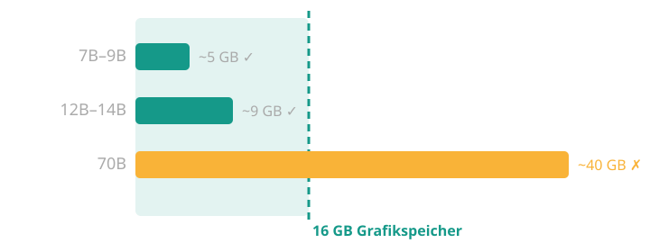{fig-align="center" width="85%"}

Installiert u.a.: `gemma4:12b`, `qwen3.5:9b`, `qwen2.5-coder:14b`

::: {.notes}
Der Grafikspeicher ist wie ein Schreibtisch: Das ganze Modell muss darauf Platz haben. Unsere Workstation hat 16 GB.

Ollama speichert Modelle komprimiert. Ein 14B-Modell belegt so etwa 8–9 GB und passt gut hinein. Der Rest wird für das Kontextfenster gebraucht.

Passt ein Modell nicht vollständig in den Grafikspeicher, lagert Ollama Teile in den normalen Arbeitsspeicher aus – das funktioniert, ist aber deutlich langsamer.

Im Wiki-Test hat Qwen2.5-Coder 14B in unter 3 Sekunden geantwortet und ein HTML-Snake-Spiel erstellt.
:::

## Token: Lokal oder Cloud?  {.smaller}

| | **Cloud** | **Lokal** |
|---|---|---|
| Modellgröße | riesig (oft geheim) | klein bis mittel (7B–14B) |
| Geschwindigkeit | hängt vom Anbieter ab | hängt vom eigenen Rechner ab |
| Kontextfenster | bis ca. 1 Mio. Token | 4.000–128.000 Token |
| Daten | verlassen den Rechner | **bleiben bei Ihnen** |
| Kosten | laufend (Abo / pro Token) | einmalig (Hardware) + Strom |

: {tbl-colwidths="[24,38,38]"}

**Merke:** Cloud = größere Modelle · Lokal = Ihre Daten bleiben bei Ihnen

::: {.notes}
Kernaussage: Lokal heißt kleinere Modelle, dafür bleiben die Daten auf dem eigenen Rechner. Cloud heißt größere Modelle, dafür verlassen die Daten den Rechner. Diese Abwägung zieht sich durch den ganzen Workshop.
:::

# Prompting

- Ziel: Prompting verstehen und optimieren

::: {.notes}
Ziel der Section: Die Qualität der Antwort hängt stark von der Frage ab.
:::

## Prompting: Was ist ein Prompt?

- **System prompt:** definiert die Rolle des Modells und den Kontext der Aufgabe. Beispiel: *„Du bist ein hilfsbereiter Assistent, der komplexe Themen einfach erklärt."*

- **User prompt:** enthält die eigentliche Frage oder Aufgabe, die das Modell beantworten soll. Beispiel: *„Erkläre mir den Unterschied zwischen KI und Machine Learning."*

:::aside
**Merke:** System prompts sind oft unsichtbar für den Benutzer, während user prompts direkt eingegeben werden. Beide zusammen bilden die Grundlage für die Interaktion mit dem Modell.
:::

::: {.notes}
Der System-Prompt ist bei ChatGPT & Co. unsichtbar vorgegeben. In Open WebUI kann man ihn selbst festlegen – das kann man kurz zeigen.
:::

## Prompting: SAND Methode

::: {.plain-table}
|   |   |
|---|---|
| **Situation** | Rolle KI-, Zielgruppe und Hintergrund definieren (Context wie z.B. E-Mail, Webseite, PDF, Bild etc. hinzufügen) |
| **Aufgabe** | Was soll die KI tun? (z.B. Text generieren, Code schreiben, Bild erstellen) |
| **Nebenbedingungen** | Regeln, Einschränkungen, (z.B. Beispiele anfügen) |
| **Darstellung** | Ausgabe Format (z.B. als Liste, Tabelle, Fließtext) |

: {tbl-colwidths="[30,70]"}
:::

::: {.notes}
SAND ist eine Eselsbrücke. Nicht jeder Prompt braucht alle vier Teile – aber je wichtiger das Ergebnis, desto mehr lohnt es sich.
:::

## Prompting: Beispiel ohne SAND

::: {.prompt-box .prompt-weak}
Schreib eine Einladung zum KI-Workshop.
:::

::: {.fragment}
Die KI muss raten:

- Wer schreibt, an wen?
- Was genau soll drinstehen?
- Wie lang, welcher Ton?
- Als E-Mail, Plakat oder Social-Media-Post?
:::

::: {.notes}
Erst das Publikum fragen, was an diesem Prompt fehlt, dann die Fragen per Klick einblenden.
:::

## Prompting: Beispiel mit SAND

::: {.prompt-box}
::: {.fragment}
[S]{.sand-letter} Schreibe für einen MINT-Verein. Die Leser sind interessierte Laien ohne Vorwissen. (anhang: PDF des Workshops mit allen fakten)
:::
::: {.fragment}
[A]{.sand-letter} Schreibe eine Einladung zu unserem nächsten KI-Workshop.
:::
::: {.fragment}
[N]{.sand-letter} Maximal 120 Wörter, freundlich, Sie-Form, keine Fachbegriffe.
:::
::: {.fragment}
[D]{.sand-letter} Als E-Mail mit Betreffzeile und drei Stichpunkten zum Ablauf.
:::
:::

::: {.notes}
Die vier Teile erscheinen nacheinander. Bei jedem Schritt kurz zurück auf die Fragen der vorherigen Folie verweisen: Jede SAND-Zeile beantwortet eine Frage, die die KI sonst hätte raten müssen.

Idealerweise live vorführen: erst den kurzen Prompt, dann den SAND-Prompt in dieselbe KI eingeben und die Ergebnisse vergleichen.
:::

## Prompting: Chat-Umgebung

Jede Chat-Umgebung weiß unterschiedlich viel über den Nutzer.

::: columns
::: {.column width="50%"}
### **Mit Gedächtnis**

- Merkt sich Vorlieben und Fakten
- Kennt frühere Chats, Dateien, E-Mails
- z.B. ChatGPT mit Memory, M365 Copilot
:::
::: {.column width="50%"}
### **Ohne Gedächtnis**

- Jeder Chat beginnt bei null
- Weiß nur, was im Prompt steht
- z.B. API, einfache Chat-Oberflächen
:::
:::

::: {.notes}
Fachbegriffe: zustandsbehaftet (stateful) vs. zustandslos (stateless). Das Sprachmodell selbst merkt sich nie etwas – das Gedächtnis kommt von der Anwendung, die im Hintergrund Informationen in den Prompt einfügt.
:::

## Prompting: Kontextfenster

- Das **Arbeitsgedächtnis** des Modells
- Gemessen in **Token** (Textbausteine)
- Alles muss hineinpassen: Prompt, Anhänge, Chatverlauf und Antwort
- Ist das Fenster voll, wird der Anfang des Chats „vergessen“

::: aside
**Merke:** Viel Kontext ist gut, aber nur so viel, wie hineinpasst.
:::

::: {.notes}
Bild: Das Kontextfenster ist wie ein Schreibtisch. Was nicht mehr draufpasst, fällt herunter – meist das Älteste zuerst.
:::

## Prompting: Wie groß ist ein Kontextfenster?

| Kontextfenster | entspricht ca. | typisch für |
|---|---|---|
| 4.000 Token | 6 Seiten | lokale Modelle (Voreinstellung Ollama) |
| 128.000 Token | 180 Seiten | viele offene Modelle (z.B. Llama, Qwen) |
| 1.000.000 Token | 1.400 Seiten | große Cloud-Modelle (z.B. Gemini, Claude) |

: {tbl-colwidths="[30,25,45]"}

::: aside
**Faustregel:** 1 Seite deutscher Text ≈ 700 Token. Stand: Oktober 2026, Werte ändern sich schnell.
:::

::: {.notes}
Lokale Werkzeuge wie Ollama stellen das Kontextfenster oft klein ein, um Arbeitsspeicher zu sparen. Ein großes Kontextfenster braucht deutlich mehr RAM bzw. VRAM.

Auch bei großen Fenstern gilt: Je voller, desto eher übersieht das Modell Details in der Mitte.
:::

## Prompting: Antworten (1/2)

### **Nichtdeterminismus**

Gleicher Prompt, unterschiedliche Antworten.

[Das Modell berechnet Wahrscheinlichkeiten für die nächsten Wörter – dabei fließen zufällige Elemente ein.]{style="color:#aaaaaa"}

### **Halluzination**

Das Modell erfindet Fakten, die nicht korrekt sind.

[Es erzeugt eine plausible Antwort, auch wenn es keine verlässlichen Informationen hat.]{style="color:#aaaaaa"}

::: {.notes}
Nichtdeterminismus: Live denselben Prompt zweimal abschicken und die Antworten vergleichen.

Halluzination: Das Modell erzeugt eine plausible Antwort, auch wenn es keine verlässlichen Informationen hat.
:::


## Prompting: Antworten (2/2)

### **Bias**

Vorurteile und Verzerrungen aus den Trainingsdaten.

[Sind die Trainingsdaten nicht ausgewogen, werden Antworten einseitig oder unfair.]{style="color:#aaaaaa"}

### **Overreliance**

Zu viel Vertrauen in die KI.

[Eigene Fähigkeiten und kritisches Denken werden vernachlässigt.]{style="color:#aaaaaa"}

::: aside
**Merke:** Antworten der KI immer hinterfragen und überprüfen.
:::

::: {.notes}
Bias: Vorurteile aus den Trainingsdaten werden übernommen.

Overreliance: Gerade bei Code und Fakten gilt – Ergebnis immer prüfen, bevor man es verwendet.
:::

# Eingabemöglichkeiten

Wie und wo kann man mit KI arbeiten?

::: {.notes}
Überleitung: Wir wissen jetzt, wie KI funktioniert und wie man gut fragt. Jetzt geht es darum, wo und wie man KI konkret benutzt.
:::


## Eingabemöglichkeiten: Übersicht

| Art | Lokal | Cloud |
|---|---|---|
| Chat im Browser (Web-UI) | Open WebUI | ChatGPT, Claude.ai, Gemini |
| Terminal / Agent (CLI) | OpenCode | Claude Code |
| Im Editor (IDE) | VS Code + Continue | GitHub Copilot |

: {tbl-colwidths="[30,30,40]"}

Das Sprachmodell ist austauschbar — die Oberfläche bestimmt, **was die KI tun darf**.

::: {.notes}
Dasselbe Modell kann in verschiedenen Oberflächen laufen. Im Chat antwortet die KI nur mit Text. Als Agent im Terminal oder Editor darf sie zusätzlich Dateien anlegen, ändern und Befehle ausführen.

Lokal heißt: Modell läuft über Ollama auf dem eigenen Rechner. Cloud heißt: Modell läuft beim Anbieter.
:::

## Web-GUI mit Tools

- **Web-GUI:** die Chat-Oberfläche im Browser, z.B. ChatGPT oder Open WebUI
- **Tools:** Werkzeuge, die die KI bei Bedarf selbst aufruft

Typische Tools: Websuche, Rechnen, Dateien lesen, Bilder erzeugen

**Ablauf:** Frage → KI wählt Tool → Anwendung führt es aus → KI antwortet mit dem Ergebnis

::: {.notes}
Das Sprachmodell allein kann nur Text lesen und schreiben. Es kann nicht ins Internet schauen, nicht zuverlässig rechnen und keine Dateien öffnen.

Die Web-GUI (Graphical User Interface = grafische Oberfläche) ist die Anwendung rund um das Modell. Sie stellt dem Modell Tools zur Verfügung. Das Modell entscheidet selbst, wann es ein Tool braucht, z.B. „Für diese Frage brauche ich aktuelle Infos → Websuche“. Die Anwendung führt die Suche aus und gibt das Ergebnis an das Modell zurück, das daraus die Antwort formuliert.

Beispiel: „Wie wird das Wetter morgen in Jülich?“ – ohne Websuche kann das Modell das nicht wissen.
:::


## Lokal: Ollama und Open WebUI

- **Ollama:** startet Sprachmodelle auf dem eigenen Rechner
- Modelle per Befehl starten, z.B. `ollama run qwen2.5-coder:14b`
- **Open WebUI:** Chat-Oberfläche im Browser, ähnlich wie ChatGPT
- Verbindet sich mit Ollama — alle Daten bleiben lokal
- Dokumente hochladen, mehrere Modelle vergleichen

::: {.notes}
Ollama ist der „Motor“: Es lädt und betreibt die Modelle. Open WebUI ist das „Armaturenbrett“: eine Weboberfläche, über die man mit den Modellen chattet.

Live-Demo: In Open WebUI ein lokales Modell auswählen und eine Frage stellen. Ggf. die Geschwindigkeit (Tokens pro Sekunde) zeigen – Bezug zur Section Token.

Modelle auf der Workstation laut Wiki: gemma4:12b (sehr gutes Allgemeinwissen), qwen3.5:9b (Allgemeinwissen), qwen2.5-coder:14b (Programmieren).
:::

## Lokal: Die Workstation im Netzwerk

| Dienst | Adresse |
|---|---|
| Open WebUI (Chat) | `http://werkstatt-workstation:8080` |
| Ollama API (z.B. für Continue) | `http://werkstatt-workstation:11434` |
| ComfyUI (Bilder, 3D) | direkt am Rechner: `http://localhost:8188` |

: {tbl-colwidths="[40,60]"}

- Nur im Netzwerk der Werkstatt (AWO) erreichbar
- Die Workstation muss eingeschaltet sein

::: {.notes}
Über die Ollama API können Programme auf dem eigenen Laptop die Modelle der Workstation nutzen – z.B. die VS-Code-Erweiterung Continue. Die Rechenarbeit erledigt dann die Workstation. Die Anleitung inklusive Konfiguration steht im Wiki.
:::

## Im Terminal: Coding-Agenten

- **Agent:** KI, die selbstständig mehrere Schritte erledigt
- Liest und schreibt Dateien, führt Befehle aus, testet
- **OpenCode:** Open Source, auch mit lokalen Modellen über Ollama
- **Claude Code:** von Anthropic, nutzt Claude-Modelle in der Cloud

::: {.notes}
Im Chat bekommt man Code als Text und muss ihn selbst kopieren und speichern. Ein Coding-Agent arbeitet direkt im Projektordner: Er legt Dateien an, ändert sie, startet Programme und reagiert auf Fehlermeldungen.

OpenCode und Claude Code funktionieren ähnlich. Der Unterschied liegt vor allem im Modell: OpenCode kann lokale Modelle nutzen, Claude Code nutzt die Claude-Modelle von Anthropic.

Beide werden später im 3D-Teil für OpenSCAD genutzt.

Auf der Workstation: In einer Konsole `ollama` starten und OpenCode auswählen. Empfohlenes Modell: qwen2.5-coder:14b.
:::

## Im Editor (IDE)

- **IDE:** Programm zum Schreiben von Code, z.B. VS Code
- KI schlägt beim Tippen Code vor
- Chat-Fenster direkt neben dem Code
- **Cloud:** GitHub Copilot · **Lokal:** z.B. Continue + Ollama

::: {.notes}
IDE = Integrated Development Environment (Entwicklungsumgebung). Die KI sieht den Code, der gerade offen ist, und kann Vorschläge passend zum Projekt machen.

Auch Claude Code und OpenCode lassen sich in VS Code einbinden – die Grenzen zwischen CLI und IDE verschwimmen.

Continue lässt sich mit der Ollama API der Workstation verbinden (Konfiguration im Wiki). Laut Wiki-Test: Qwen2.5-Coder 14B hat in unter 3 Sekunden ein HTML-Snake-Spiel erstellt.
:::

## Live Coding Snake

::: {.chat-input}
Baue ein kleines Snake-Spiel, welches direkt im Browser läuft.
:::

::: {.notes}
Live-Demo: Denselben Prompt einmal im Web-UI (Open WebUI oder ChatGPT) und einmal im Coding-Agenten (OpenCode oder Claude Code) eingeben.

Web-UI: Code erscheint als Text im Chat und muss kopiert und gespeichert werden. Agent: Die Datei wird direkt angelegt und kann sofort geöffnet werden.
:::

## Ergebnis: Snake {background-color="#2c3e50"}

```{=html}
<iframe src="demo-snake.html"
  style="width:100%;height:85vh;border:none;background:#2c3e50;">
</iframe>
```

::: {.notes}
Das Spiel live ausprobieren. Hinweis: Dieser Code wurde vollständig von der KI geschrieben.
:::

## Code ist Text

LLMs schreiben Text — und **Code ist auch nur Text**.

- Webseiten und Spiele (HTML, JavaScript)
- Präsentationen (diese hier ist mit Quarto geschrieben)
- **3D-Modelle** (OpenSCAD)

**Merke:** Alles, was man als Code beschreiben kann, kann KI gut.

::: {.notes}
Überleitung zum Hauptteil: Wenn KI ein Spiel programmieren kann, kann sie auch ein 3D-Modell programmieren. Genau das macht OpenSCAD möglich.
:::

# 3D-Generierung mit KI

## Viele Wege zum 3D-Modell

::: columns
::: {.column width="33%"}
### Weg 1: Text → Code → 3D-Modell

- KI schreibt OpenSCAD-Code
- Präzise Maße, jederzeit änderbar
:::
::: {.column width="33%"}
### Weg 2: 2D Bild → 3D-Modell

- KI erzeugt aus einem Bild ein 3D-Modell
- Organische Formen, Figuren
:::
::: {.column width="33%"}
### Weg 3: MCP Blender von KI steuern lassen

- xxx
:::
:::


Alle Wege können 100% **lokal** laufen aber auch mit **cloud** Modelle kombiniert werden.


# Weg 1: Text → Code → 3D

**OpenSCAD** ist eine Programmiersprache für 3D-Modelle — statt mit der Maus zu modellieren, beschreibt man das Modell als Code.

**Das Prinzip:** Prompt an KI → SCAD-Code wird erzeugt → fertiges 3D-Modell


::: {.notes}
Hier kommt alles zusammen: Coding-Agent (Eingabemöglichkeiten) + gute Prompts (SAND) + Code ist Text.
:::

## OpenSCAD: Was ist OpenSCAD?

- Textbasierte Modellierung: Das 3D-Objekt entsteht rein durch Code. Es gibt keine Möglichkeit, Formen direkt mit der Maus in der 3D-Ansicht zu ziehen oder zu verschieben.
- Grundformen wie Zylinder, Quader und Kugeln werden kombiniert, subtrahiert und transformiert
- Ergebnis ist **geometrisch exakt**: gerade Kanten, klare Formen — ideal für Technik und Architektur, ungeeignet für freie, organische Formen

::: {.notes}
OpenSCAD ist kostenlos und Open Source. Parameter oben in der Datei (z.B. Breite, Höhe) kann man später ändern, ohne den restlichen Code zu verstehen.
:::

## OpenSCAD: Der Prompt

::: {.prompt-box}
[S]{.sand-letter} Du bist OpenSCAD-Experte. Ich bin Einsteiger und möchte das Modell später selbst anpassen durch Parameter.

[A]{.sand-letter} Erstellen einen runden Turm mit kegelförmigem Dach.

[N]{.sand-letter} Alle Maße als Parameter ganz oben, jeweils mit deutschem Kommentar. Im restlichen Code keine festen Zahlen. Turm grün (#159989), Dach gelb (#F9B338).

[D]{.sand-letter} Eine einzige .scad-Datei, kurz und übersichtlich kommentiert.
:::

**Merke:** Der Mensch ändert die **Parameter** — den Code schreibt die KI.

::: {.notes}
Die SAND-Methode aus dem Prompting-Teil, angewendet auf 3D.

Der wichtigste Teil steht unter N: Parameter. Ohne diese Vorgabe schreibt die KI Zahlen oft mitten in den Code (z.B. `cylinder(h = 50, r = 10)`). Dann muss man den Code verstehen, um etwas zu ändern. Mit Parametern ganz oben reicht es, eine Zahl auszutauschen – auch ohne Programmierkenntnisse.

„Keine festen Zahlen im restlichen Code“ sorgt dafür, dass wirklich alles über die Parameter steuerbar ist. Die Farben helfen später zu erkennen, welcher Code welches Teil erzeugt.
:::

## OpenSCAD: Ein einfaches Beispiel

::: columns
::: {.column width="70%"}
```openscad
// Parameter
hoehe      = 50;  // Höhe des Turms
radius     = 10;  // Radius des Turms
dach_hoehe = 20;  // Höhe des Dachs
ueberstand = 3;   // So weit steht das Dach über

// Turm (grün)
color("#159989")
  cylinder(h = hoehe, r = radius);

// Dach: Kegel (gelb)
color("#F9B338")
  translate([0, 0, hoehe])
    cylinder(h = dach_hoehe, r1 = radius + ueberstand, r2 = 0);
```
:::
::: {.column width="30%"}
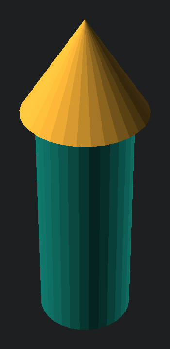{fig-align="center" height="400"}
:::
:::

**Parameter ändern** (z.B. `hoehe = 80`) → der Turm wird sofort höher.

::: {.notes}
Zeile für Zeile:

- Oben stehen vier Parameter – so wie im Prompt verlangt. Diese Zahlen kann jeder ändern, ohne den Rest zu verstehen.
- `cylinder` erzeugt den Turm als Zylinder.
- `translate` schiebt das Dach nach oben – genau um die Höhe des Turms.
- Das Dach ist ebenfalls ein Zylinder, der oben auf Radius 0 zuläuft – also ein Kegel.
- `color` färbt jedes Teil ein – so sieht man sofort, welche Codezeilen welches Teil erzeugen.

Die Datei liegt unter `scad/beispiel-turm.scad` und kann in OpenSCAD geöffnet werden (F5 = Vorschau).
:::


## OpenSCAD: Hexenturm Jülich


::: columns
::: {.column width="60%"}

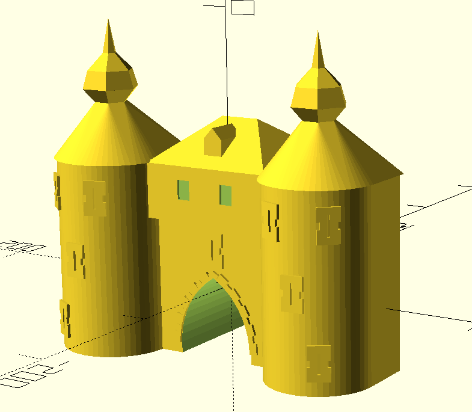{fig-align="center" height="500"}

:::
::: {.column width="40%"}

Der fertige Hexenturm — vollständig aus OpenSCAD-Code generiert, mit Hilfe von KI.
:::
:::

::: {.notes}
Der Hexenturm ist ein Wahrzeichen von Jülich. Das Modell entstand in mehreren Schritten mit Claude Code.
:::

## OpenSCAD: Modularer Aufbau

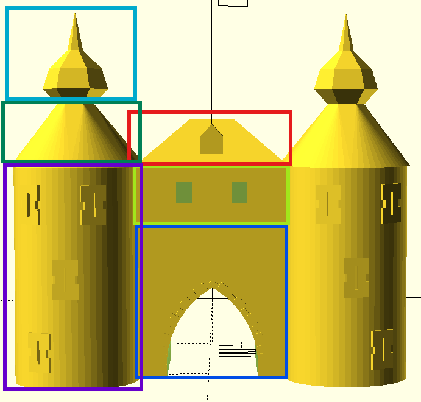{fig-align="center" height="500"}

::: aside
Das Modell besteht aus einzelnen Modulen: Turmspitze, Kegelhelm, Turmschaft, Mittelgebäude und Toreinfahrt — jedes separat im Code definiert und kombiniert.
:::

::: {.notes}
Wie beim Prompting gilt: große Aufgaben in kleine Teile zerlegen. Jedes Modul wurde einzeln erstellt und dann zusammengesetzt.
:::

## OpenSCAD: Prompt mit Skizze

::: columns
::: {.column width="40%"}
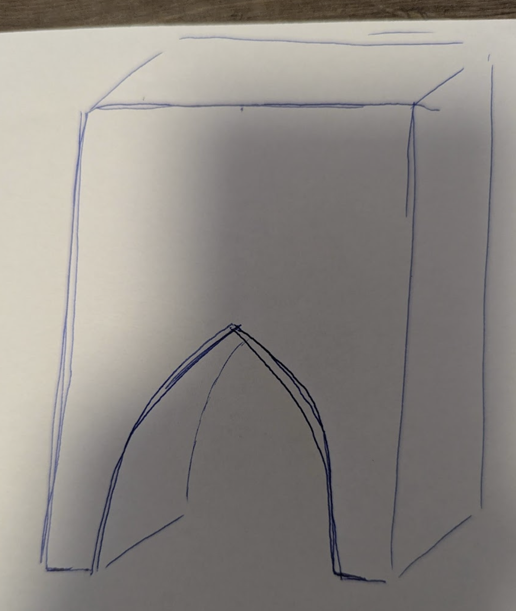{fig-align="center" height="450"}
:::
::: {.column width="60%"}
::: {.chat-input}
Erstelle ein Rechteck, durch das ein Tunnel geht. Anbei ein Bild, wie ich es mir vorstelle.
:::

[Skizze als Anhang im Chat · Prompt für die Folie vereinfacht]{style="color:#aaaaaa;font-size:0.7em"}
:::
:::

::: {.notes}
Eine Skizze im Prompt hilft enorm – multimodale Modelle können sie auswerten (Bezug zur Folie Chihuahua oder Muffin).
:::

## OpenSCAD: Details im Code

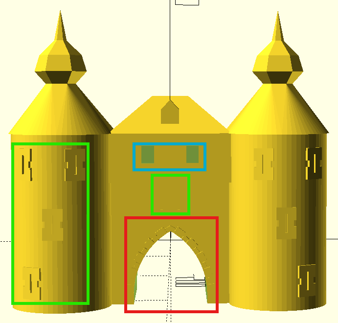{fig-align="center" height="500"}

::: aside
Details wie Fensteröffnungen, Torbogen und Wandstruktur wurden später hinzugefügt.
:::

::: {.notes}
Details wurden erst ergänzt, als die Grundform stand.
:::

## OpenSCAD: Detail-Prompt mit Skizze

::: columns
::: {.column width="40%"}
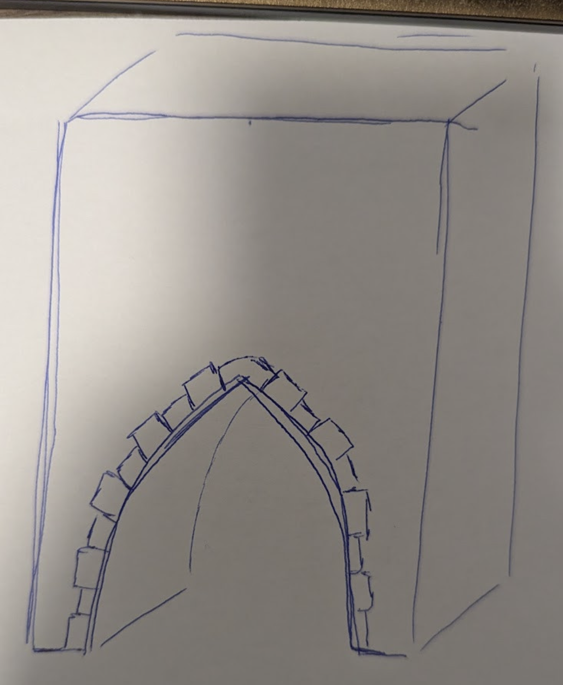{fig-align="center" height="450"}
:::
::: {.column width="60%"}
::: {.chat-input}
Entlang des Tunnels hätte ich gerne an nur einer Seite eine Verzierung: Steine, die abwechselnd größer und kleiner werden. Oben mittig ist ein Spezialstein. Anbei ein Bild, wie ich es mir etwa vorstelle.
:::

[Skizze als Anhang im Chat · Prompt für die Folie vereinfacht]{style="color:#aaaaaa;font-size:0.7em"}
:::
:::

::: {.notes}
Auch hier: Text plus Bild. Die KI übersetzt die Skizze in Code.
:::

## OpenSCAD: Fotos des 3D-Drucks

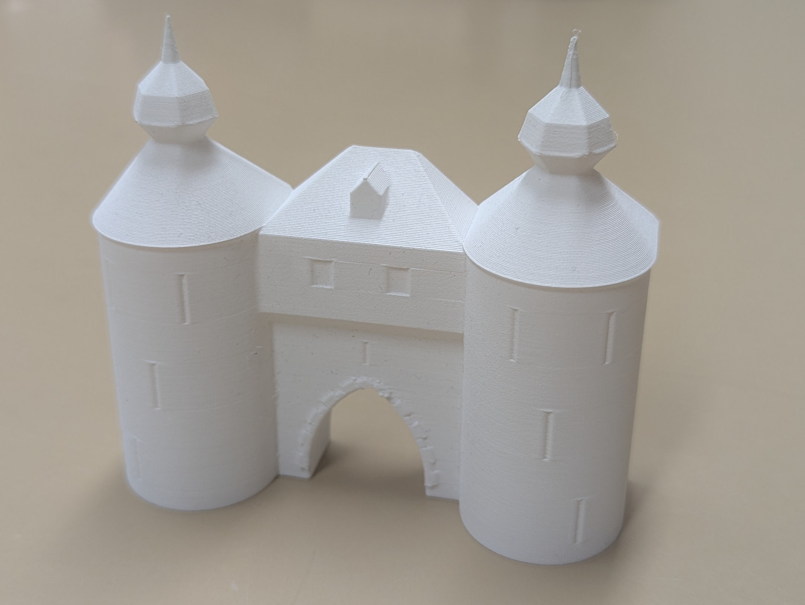{fig-align="center" height="500"}

## OpenSCAD mit KI: Zusammenfassung


- Parameteriesierung: Um kleine details später selber anzupassen.
- Module: Große Aufgaben in kleine Teile zerlegen.
- Selbstgezeichnete Skizzen: Multimodale Modelle können sie auswerten.
- Iterativer Prozess: Feedback → Anpassung → Verbesserung

**Merke:** KI ersetzt keine CAD-Kenntnisse — sie macht den Einstieg deutlich einfacher.

::: {.notes}
Wichtig ist der iterative Ablauf: nicht alles in einem Prompt, sondern Schritt für Schritt.
:::

## Praxisbeispiel: Tischfuß als Ersatzteil

::: columns
::: {.column width="45%"}
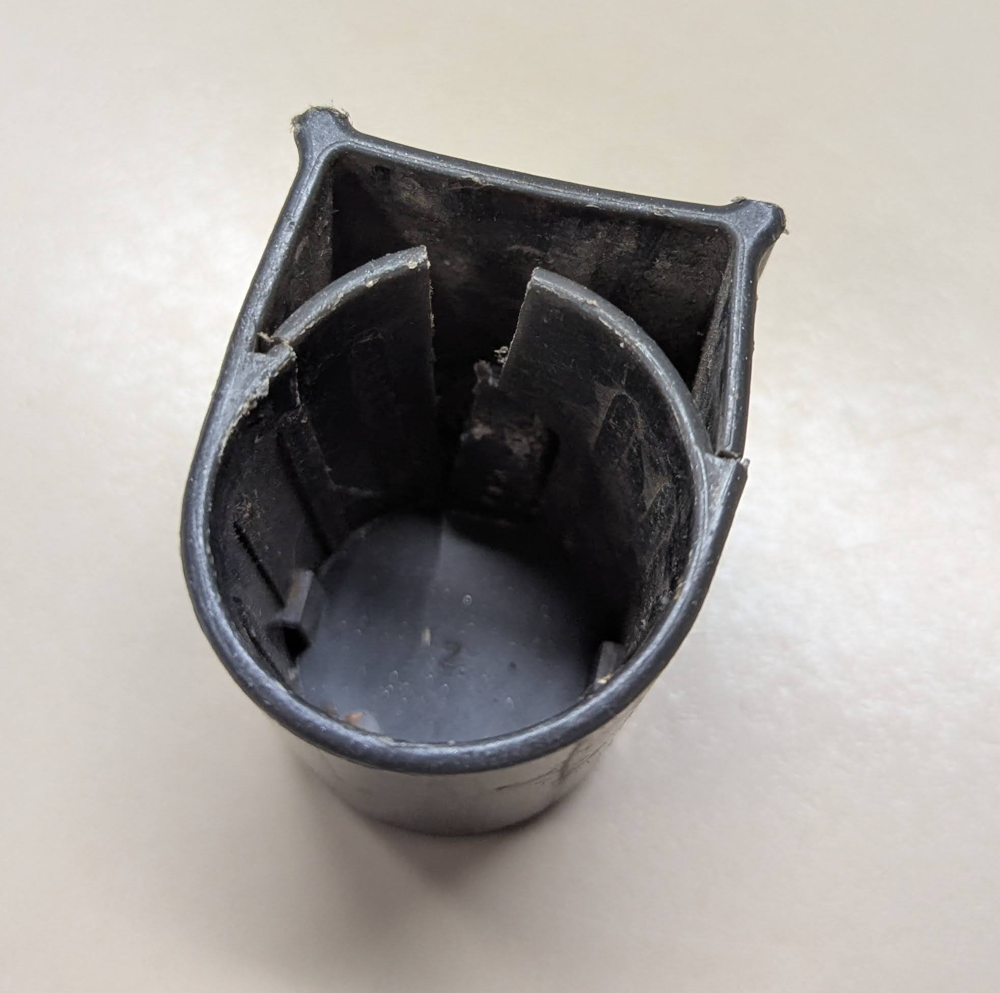{fig-align="center" height="420"}
:::
::: {.column width="55%"}
- Alter Kunststoff-Fuß eines Tischbeins: **gebrochen**
- Maße mit dem Messschieber abgenommen
- Ziel: Ersatzteil mit KI konstruieren und **selbst drucken**
:::
:::

::: {.notes}
Ein echtes Beispiel aus der Werkstatt – genau der Fall „Ersatzteil“, der auf der 3D-Druck-Folie am Anfang genannt wurde.

Die Form ist technisch und geometrisch: Rohr, gerade Flächen, feste Maße. Damit ist sie ideal für Weg 1 (OpenSCAD).
:::

## Tischfuß: Der Prompt

::: {.prompt-box}
Die Endform ist ein Rohr, das auf einer Seite quadratisch verlängert ist.

- Materialstärke 3 mm · Tiefe außen 55 mm · Höhe außen 57 mm · Breite außen 41 mm
- Innen Ø 36 mm, nach 10 mm: 12 Streben (4 mm breit, 0,5 mm hoch) → Ø 35 mm
- Unten Streben: 11 mm lang, 2 mm dick, 6 mm breit
- Oben offen, unten geschlossen
- ABS, FDM-Drucker Prusa CORE One
:::

[Prompt für die Folie leicht gekürzt]{style="color:#aaaaaa;font-size:0.7em"}

::: {.notes}
Der Prompt beschreibt die Form in Worten und gibt alle gemessenen Maße an. Die Klemmstreben innen sorgen dafür, dass der Fuß fest auf dem Rohr sitzt (Presspassung).

Material und Drucker stehen mit im Prompt: So kann die KI die Druckrichtung berücksichtigen – der Boden liegt beim Druck auf dem Druckbett, die Öffnung zeigt nach oben.

Im Original-Prompt stand „57m“ statt „57 mm“ – die KI hat das richtig interpretiert. Trotzdem: Maße immer genau prüfen.
:::

## Tischfuß: Ergebnis in OpenSCAD

::: columns
::: {.column width="45%"}
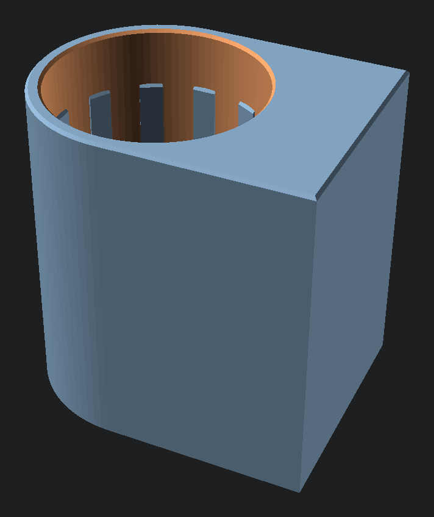{fig-align="center" height="420"}
:::
::: {.column width="55%"}
```openscad
// ---- Parameter ----
hoehe        = 57;  // Außenhöhe
tiefe        = 55;  // Außentiefe
breite       = 41;  // Außenbreite
bohrung_d    = 36;  // Bohrung
rippe_anzahl = 12;  // Klemmrippen
// ... über 20 Parameter
```

[Jedes Maß einzeln anpassbar]{style="color:#aaaaaa;font-size:0.7em"}

:::
:::

::: {.notes}
Die KI hat alle Maße als Parameter angelegt – passt der Fuß nicht genau, ändert man z.B. `bohrung_d` um 0,2 mm und druckt neu, ohne den Code anzufassen.

Fasen = abgeschrägte Kanten. Die Einführschräge erleichtert das Aufstecken auf das Rohr.

Die vollständige Datei liegt unter `scad/fuss.scad`.
:::

## Tischfuß: Alt und neu

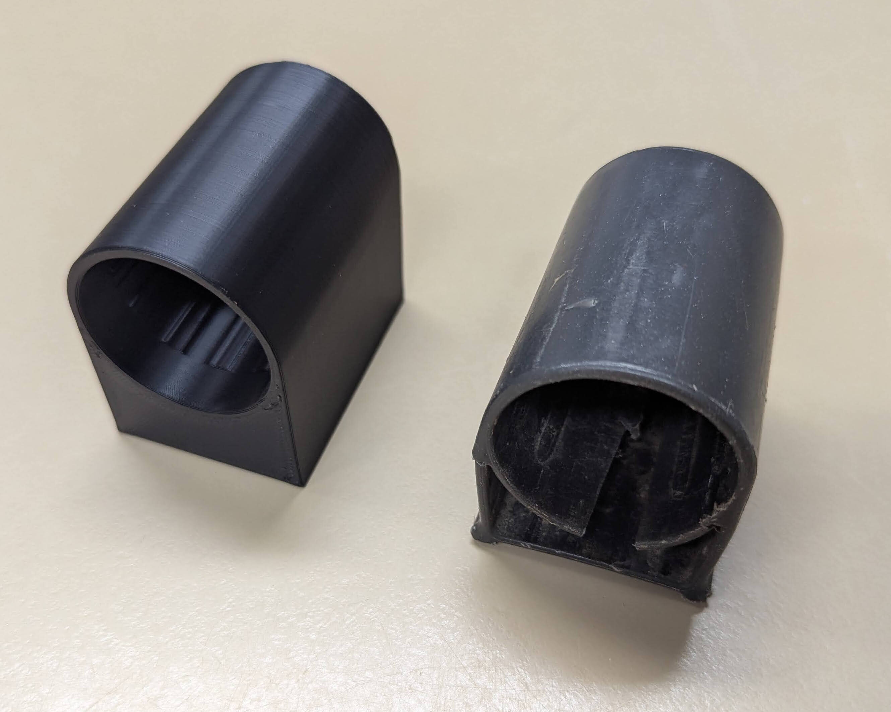{fig-align="center" height="480"}

[Links: neu gedruckt (ABS) · Rechts: das alte, gebrochene Original]{style="color:#aaaaaa;font-size:0.7em"}

::: {.notes}
Vom gebrochenen Teil zum gedruckten Ersatz: messen, beschreiben, von der KI konstruieren lassen, drucken. Genau der rote Faden dieses Workshops.
:::

# Weg 2: Bild → 3D

Aus einem Foto oder einer Zeichnung wird ein 3D-Modell.

- KI „errät“ auch die nicht sichtbaren Seiten
- Ergebnis: Oberfläche aus Dreiecken (Mesh), oft mit Farbe
- Gut für Figuren und organische Formen, weniger für exakte Maße

::: {.notes}
Im Gegensatz zu Weg 1 entsteht hier kein Code, sondern direkt eine Oberfläche aus vielen kleinen Dreiecken. Das ist gut für Figuren, aber Maße lassen sich nachträglich kaum ändern.
:::

## Lokal: ComfyUI + Hunyuan3D

- **ComfyUI:** Oberfläche, in der man KI-Schritte als **Knoten** verbindet
- Fertige Vorlagen über das Menü **Templates**
- Bild erzeugen: Vorlage **Z-Image-Turbo** (Text → Bild)
- 3D erzeugen: Vorlage **HY 3D 2.1** = Hunyuan3D (Bild → 3D)
- Läuft auf der Workstation — braucht viel Grafikspeicher

::: {.notes}
ComfyUI ist ein Knoten-Editor: Jeder Kasten ist ein Arbeitsschritt (Bild laden, Modell laden, 3D erzeugen, speichern). Die Kästen werden mit Linien verbunden.

Auf der Workstation: ComfyUI im Browser unter http://localhost:8188 öffnen → Templates → „Image“ bzw. „3D Model“ wählen. Die Installation der Vorlagen ist bereits erledigt.

Hinweis: ComfyUI gibt Modelle nicht automatisch aus dem Speicher frei – zwischen Bild- und 3D-Erzeugung ggf. Speicher freigeben.
:::

## Gute Vorlagen für Bild → 3D

- **Ein** Objekt pro Bild
- Hintergrund entfernt oder **einfarbig**
- Gleichmäßige Beleuchtung **mit Schatten** — so erkennt die KI die Form
- Kein Text, keine Logos
- Ganzes Objekt sichtbar, nichts abgeschnitten

::: {.notes}
Die ersten vier Punkte stammen aus der Anleitung im Wiki. Schatten sind wichtig, weil die KI daraus die räumliche Form ableitet.

Diese Regeln schreibt man direkt in den Bild-Prompt – das zeigt das Beispiel auf der nächsten Folie.
:::

## Beispiel: Muttkrat prompt

::: {.prompt-box}
**Positiv:** Full-body character render of a huge, very plump toad … low poly 3D style … isolated and centered … white laboratory coat, round brass goggles, leather tool belt … studio three-point lighting … plain solid cyan background … whole figure visible from head to feet
:::

::: {.prompt-box .prompt-weak}
**Negativ:** slim, tall, gradient background, floor, cast shadow, cropped, multiple characters, photorealistic, text, watermark, extra limbs …
:::

[Prompt gekürzt · vollständig in `toad_prompt.md`]{style="color:#aaaaaa;font-size:0.7em"}

::: {.notes}
Bildmodelle kennen zwei Prompts:

- **Positiv-Prompt:** Was soll auf dem Bild sein?
- **Negativ-Prompt:** Was soll auf keinen Fall auf dem Bild sein?

Die Regeln von der vorherigen Folie stecken direkt im Prompt: „isolated and centered“ (ein Objekt), „plain solid background“ (einfarbiger Hintergrund), „three-point lighting“ (gleichmäßiges Licht), „whole figure visible“ (nichts abgeschnitten). Im Negativ-Prompt: kein Boden, kein Schattenwurf, kein Text, nicht abgeschnitten.

„low poly 3D style“ sorgt für klare, einfache Formen – die lassen sich besser in 3D umsetzen und drucken.

Bildmodelle verstehen Englisch meist besser als Deutsch.
:::

## Beispiel: Schritt 1 — Bild erzeugen

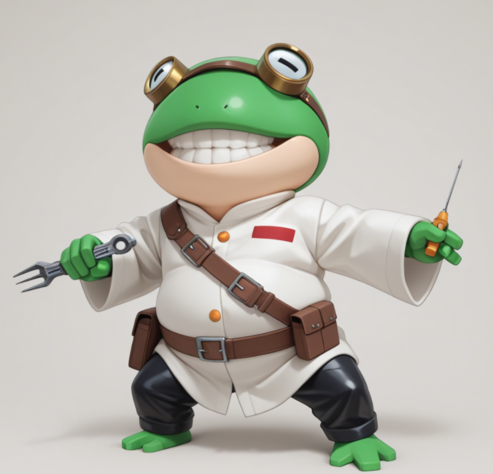{fig-align="center" height="480"}

::: {.notes}
Erzeugt mit Z-Image-Turbo in ComfyUI auf der Workstation.

Gut zu sehen: Im Prompt stand „cyan background“ – herausgekommen ist ein hellgrauer Hintergrund. Die KI hält sich nicht immer an jedes Detail (vgl. Nichtdeterminismus im Prompting-Teil). Für den nächsten Schritt reicht der einfarbige Hintergrund trotzdem.
:::

## Beispiel: Schritt 2 — Bild → 3D-Modell

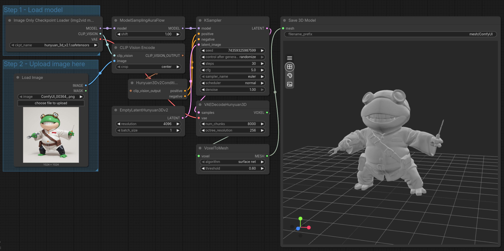{fig-align="center" height="450"}

::: {.notes}
Das Bild aus Schritt 1 wird unter „Step 2 – Upload image“ hochgeladen. Hunyuan3D 2.1 erzeugt daraus ein 3D-Modell, das direkt in ComfyUI gedreht werden kann.

Die Rückseite hat die KI selbst „erraten“ – sie war auf dem Bild nicht zu sehen.

Ergebnis ist eine GLB-Datei (`glb/toad.glb`), die für den Druck noch in STL umgewandelt wird.
:::


## Beispiel: Schritt 3 — Ab in den Drucker

::: columns
::: {.column width="45%"}
1. **Umwandeln:** `.glb` → `.stl` (z.B. mit Blender oder assimp)
2. **Slicen:** `.stl` in PrusaSlicer laden und skalieren
3. **Prüfen:** Fehler im Mesh korrigieren
4. **Drucken**
:::
::: {.column width="55%"}
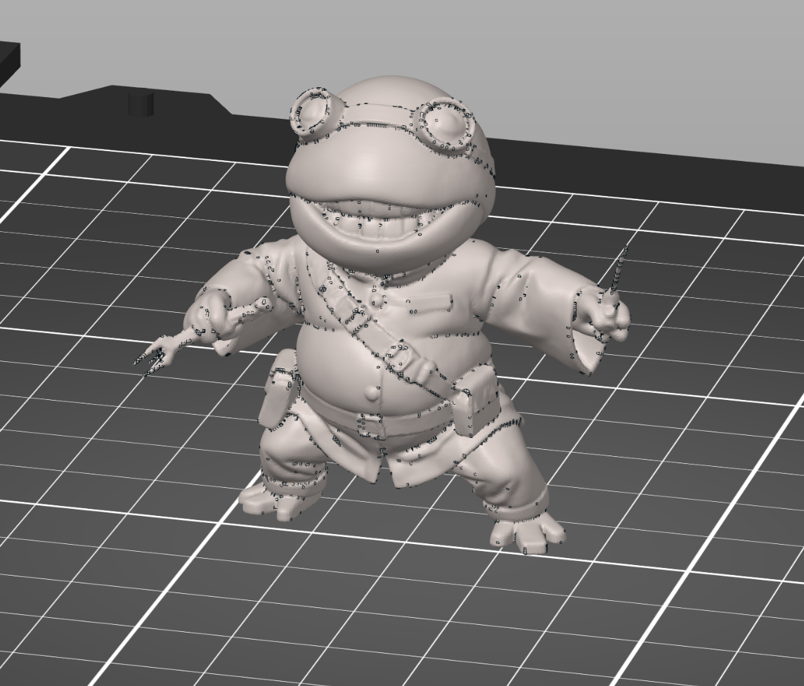{fig-align="center" height="380"}

:::
:::

::: {.notes}
GLB ist das Austauschformat für 3D-Modelle mit Farbe und Textur. Drucker brauchen nur die Form – dafür ist STL das übliche Format.

Bild-zu-3D-Modelle haben keine echten Maße. Im Slicer wird der Toad deshalb auf eine passende Größe skaliert (Bauraum des Druckers: 250 × 220 × 270 mm).

Laut PrusaSlicer: 7,24 g Filament, 1 h 21 min Druckzeit, rund 20 Cent Material.
:::

## Vom Modell zum Druck: Typische Probleme

::: columns
::: {.column width="33%"}
::: {.card}
**Löcher im Mesh**

Oberfläche ist nicht geschlossen

→ reparieren lassen
:::
:::
::: {.column width="34%"}
::: {.card}
**Zu dünne Wände**

Brechen oder werden gar nicht gedruckt

→ größer skalieren
:::
:::
::: {.column width="33%"}
::: {.card}
**Überhänge**

Teile hängen frei in der Luft

→ Stützmaterial
:::
:::
:::

::: aside
Viele Slicer reparieren kleine Mesh-Fehler automatisch — für größere Probleme hilft z.B. Blender.
:::

::: {.notes}
Beim Toad gut zu sehen: Die Werkzeuge in den Händen sind sehr dünn – genau so eine Stelle, die beim Druck abbrechen kann. Die ausgestreckten Arme sind Überhänge und brauchen Stützmaterial.

Bei OpenSCAD-Modellen (Weg 1) treten diese Probleme deutlich seltener auf, weil die Form aus exakten Grundkörpern besteht.
:::

## TODO FOTO

FOTO

# Weg 3: MCP (Model Context Protocol)

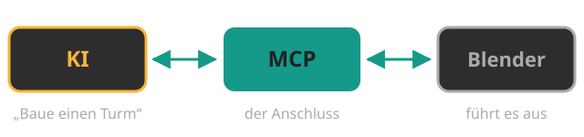{fig-align="center" width="80%"}

- **MCP** (Model Context Protocol): offener Standard, über den eine KI andere Programme bedient
- Wie ein **USB-Anschluss für KI** — einmal eingesteckt, kann sie loslegen
- Beispiel: In **Blender** legt die KI Objekte an und verändert sie
- Sehr gut für organische Formen. 

[Spannend — aber nicht Teil dieses Workshops.]{style="color:#aaaaaa"}

::: {.notes}
MCP wurde 2024 von Anthropic veröffentlicht und wird inzwischen von vielen KI-Anwendungen unterstützt. Ein Programm stellt über MCP „Werkzeuge“ bereit (z.B. „Würfel erzeugen“, „Objekt verschieben“), die KI ruft sie bei Bedarf auf – genau wie die Tools bei der Folie „Web-GUI mit Tools“.

Warum nicht heute: Für Einsteiger ist der Weg über Code (OpenSCAD) bzw. Bild (Hunyuan3D) nachvollziehbarer. MCP-Steuerung von Blender setzt Blender-Kenntnisse voraus.
:::

# Zusammenfassung

::: {.notes}
Kurzer Rückblick, bevor die Fragerunde startet.
:::


## Vergleich der Wege

| | **Weg 1: OpenSCAD + KI** | **Weg 2: Bild → 3D** |
|---|---|---|
| Eingabe | Text (und Skizzen) | Foto oder Zeichnung |
| Ergebnis | Code → exaktes Modell | Mesh (Dreiecksnetz) |
| Stärke | technische Teile, Gebäude | Figuren, organische Formen |
| Lokal | OpenCode + Ollama | ComfyUI + Hunyuan3D |
| Cloud | Claude Code, GitHub Copilot | Meshy.ai, tripo3d.ai|

: {tbl-colwidths="[18,41,41]"}

::: {.notes}
Faustregel: Muss es passen (Ersatzteil, Halterung)? → Weg 1. Soll es gut aussehen (Figur, Deko)? → Weg 2.
:::


## Das sollten Sie mitnehmen

- Antworten der KI immer hinterfragen und überprüfen
- Je weniger die KI weiß, desto mehr Kontext muss der Prompt liefern
- Lokal: Daten bleiben bei Ihnen · Cloud: größere Modelle
- Alles, was man als Code beschreiben kann, kann KI gut
- KI ersetzt keine Fachkenntnisse — sie macht den Einstieg einfacher

::: {.notes}
Die Merke-Sätze aus den einzelnen Sections.
:::

# Fragen & Diskussion

Haben Sie Fragen oder Anmerkungen?

::: {.notes}
Offene Runde. Danach je nach Zeit: Bonus-Teile.
:::

# Bonus: HuggingFace

Der Spielplatz für offene KI-Modelle.

::: {.notes}
Bonus je nach verfügbarer Zeit. Alle Demos laufen kostenlos im Browser.
:::

## HuggingFace: Der KI-Spielplatz

- Plattform mit über **1 Million** frei verfügbarer KI-Modelle
- **Spaces:** fertige Demos direkt im Browser
- Keine Installation, keine eigene Grafikkarte nötig
- Ideal, um ein Modell auszuprobieren, bevor man es lokal installiert

::: aside
[huggingface.co](https://huggingface.co) — kostenlose Basisnutzung, Stand: Oktober 2026
:::

::: {.notes}
Vergleichbar mit GitHub, aber für KI-Modelle. Viele Modelle aus diesem Workshop (z.B. Qwen, Gemma, Hunyuan3D) gibt es dort zum Herunterladen – und oft auch als Demo zum Ausprobieren.

Die kostenlosen Demos laufen auf geteilter Hardware: Bei vielen Nutzern kann es Wartezeiten geben.
:::

## HuggingFace: Zum Ausprobieren

| Eingabe → Ausgabe | Demo |
|---|---|
| Text → Bild | [FLUX.1](https://huggingface.co/spaces/black-forest-labs/FLUX.1-schnell) |
| Text → Video | [Wan2.2](https://huggingface.co/spaces/r3gm/wan2-2-fp8da-aoti-preview-2) |
| Sprache → Text | [Whisper](https://huggingface.co/spaces/hf-audio/whisper-large-v3) |
| Text → Sprache | [Kokoro TTS](https://huggingface.co/spaces/hexgrad/Kokoro-TTS) |
| Bild → 3D | [Hunyuan3D-2.1](https://huggingface.co/spaces/tencent/Hunyuan3D-2.1) · [Pixal3D](https://huggingface.co/spaces/TencentARC/Pixal3D) |

: {tbl-colwidths="[40,60]"}

::: aside
Stand: Oktober 2026 — Demos kommen und gehen.
:::

::: {.notes}
Live je nach Zeit eine Demo zeigen, z.B. Bild → 3D mit Hunyuan3D – das ist die Cloud-Variante von Weg 2 aus dem Hauptteil.
:::

# Bonus: Termine-Webseite

Eine mit KI erstellte Webseite: Sie zeigt die Termine des Vereins und erklärt, wie diese öffentlich bereitgestellt werden.

::: {.notes}
Praxisbeispiel aus dem Verein: Die Termine-Webseite wurde mit KI programmiert.
:::


## Plan erstellen

Der Plan ist das Herzstück, um die KI in die richtige Richtung zu lenken. Je genauer er ist, desto eher entsteht, was man sich vorstellt.

- Technologie einschränken
- Zielgruppe festlegen und inhaltliche Schwerpunkte setzen
- Alles in Bereiche aufteilen (Header, Footer, Inhaltsbereiche)
- CI festlegen (Farben, Schriften, Logo)
- Code-Qualität und Sicherheit festlegen

::: {.notes}
Der Plan entspricht der SAND-Methode im Großen: Situation, Aufgabe, Nebenbedingungen und Darstellung werden vorab festgelegt.
:::

## Reicht ein Plan?

Nein — auch ein guter Plan liefert selten sofort das perfekte Ergebnis.

- Ergebnis ansehen, dann **in kleinen Schritten** nachbessern
- Ein Prompt pro Änderung
- Beispiele auf den nächsten Folien: Herzanimation und Achievements

::: {.notes}
Überleitung zu den Prompt-Beispielen.
:::

## Prompt-Beispiel: Herzanimation 1/2

- Um der KI zu erklären, welche Animation gerne hätte, wurde auf eine example Seite verlinkt [gsap.com](https://gsap.com/community/forums/topic/28814-using-gsap-to-loop-a-pulsing-animation/) (fig. 1)
- folgend wurde gepromptet, dass die Animation mehr wie das eigentliche Herz aussehen soll (fig. 2).

```{=html}
<style>
  .hd-wrap { position:relative; display:flex; align-items:center; justify-content:center; width:120px; height:120px; }
  .hd-ring { position:absolute; width:48px; height:48px; background:#F9B338; opacity:0; top:50%; left:50%; margin-top:-24px; margin-left:-24px; }
  .hd-ring.circle { border-radius:50%; }
  .hd-ring.heart { clip-path:path('M4 19a11 11 0 0 1 19.182-7.352 1.12 1.12 0 0 0 1.636 0A10.98 10.98 0 0 1 44 19c0 4.58-3 8-6 11l-10.984 10.626a4 4 0 0 1-6 .038L10 30c-3-3-6-6.4-6-11'); }
  .hd-icon { position:relative; z-index:1; width:48px; height:48px; color:#F9B338; }
</style>

<div style="display:flex;justify-content:center;align-items:center;height:20vh;gap:160px;background:#222222;">

  <div class="hd-wrap" id="hd-left">
    <div class="hd-ring circle"></div>
    <div class="hd-ring circle"></div>
    <div class="hd-ring circle"></div>
    <svg class="hd-icon" viewBox="0 0 24 24" fill="none" stroke="currentColor" stroke-width="2" stroke-linecap="round" stroke-linejoin="round" aria-hidden="true">
      <path d="M20.84 4.61a5.5 5.5 0 0 0-7.78 0L12 5.67l-1.06-1.06a5.5 5.5 0 0 0-7.78 7.78l1.06 1.06L12 21.23l7.78-7.78 1.06-1.06a5.5 5.5 0 0 0 0-7.78z"/>
    </svg>
  </div>

  <div class="hd-wrap" id="hd-right">
    <div class="hd-ring heart"></div>
    <div class="hd-ring heart"></div>
    <div class="hd-ring heart"></div>
    <svg class="hd-icon" viewBox="0 0 24 24" fill="none" stroke="currentColor" stroke-width="2" stroke-linecap="round" stroke-linejoin="round" aria-hidden="true">
      <path d="M20.84 4.61a5.5 5.5 0 0 0-7.78 0L12 5.67l-1.06-1.06a5.5 5.5 0 0 0-7.78 7.78l1.06 1.06L12 21.23l7.78-7.78 1.06-1.06a5.5 5.5 0 0 0 0-7.78z"/>
    </svg>
  </div>

</div>

<script>
(function () {
  var started = false;
  function startHD() {
    if (started || typeof gsap === 'undefined') { return; }
    started = true;
    var tl = gsap.timeline({ repeat: -1 });
    tl.fromTo('#hd-left .hd-ring',
      { scale: 1, opacity: 0.5 },
      { scale: 2.2, opacity: 0, duration: 1.8, stagger: 0.6, ease: 'power1.out' });
    var tl2 = gsap.timeline({ repeat: -1 });
    tl2.fromTo('#hd-right .hd-ring',
      { scale: 1, opacity: 0.5 },
      { scale: 2.2, opacity: 0, duration: 1.8, stagger: 0.6, ease: 'power1.out' });
  }
  if (typeof Reveal !== 'undefined') {
    Reveal.on('slidechanged', function (e) {
      if (e.currentSlide.querySelector('#hd-left')) { startHD(); }
    });
    Reveal.on('ready', function (e) {
      if (e.currentSlide.querySelector('#hd-left')) { startHD(); }
    });
  } else {
    document.addEventListener('DOMContentLoaded', startHD);
  }
}());
</script>
```

::: {.notes}
Links die ursprüngliche Animation (Kreis), rechts nach dem zweiten Prompt (Herzform).
:::

## Prompt-Beispiel: Herzanimation 2/2

```{=html}
<div class="prompt-window">
  <div class="prompt-window-bar">Prompt 1</div>
  <div class="prompt-window-body">
    <div class="prompt-bubble">
      Erstelle im Sponsoring-Bereich ein Herz Icon und nutze die Animation von gsap.com/community/forums/topic/28814‑using‑gsap‑to‑loop‑a‑pulsing‑animation/
    </div>
  </div>
</div>
```

```{=html}
<div class="prompt-window">
  <div class="prompt-window-bar">Prompt 2</div>
  <div class="prompt-window-body">
    <div class="prompt-bubble">
      Die Animation vom Herz Icon im Sponsoring-Bereich soll mehr wie ein Herz aussehen.
    </div>
  </div>
</div>
```

::: {.notes}
Zwei kurze Prompts reichen – der erste mit Link als Vorlage, der zweite als Verfeinerung.
:::

## CLAUDE.md

- Textdatei im Projekt mit Regeln und Wissen für die KI
- Wird bei jeder Sitzung automatisch mitgelesen
- Im Internet manchmal als „Token-Fresser“ kritisiert — aber sehr hilfreich
- Tipp: Die KI regelmäßig bitten, neue Erkenntnisse in der CLAUDE.md zu ergänzen

::: {.notes}
Die CLAUDE.md ist das Gedächtnis des Projekts (vgl. Folie Chat-Umgebung: mit/ohne Gedächtnis). Sie kostet bei jeder Anfrage etwas Kontext, spart aber viele Wiederholungen und Korrekturen.
:::

## Prompt-Beispiel: Achievements

Die Minispiele auf der Seite werden durch gelben Text oder Animationen angeteasert. Für den Achievement-Bereich reichte ein einziger Prompt:

::: {.chat-input}
Finde alle klickbaren Spiele mit gelbem Text. Erstelle einen Achievement-Bereich. Achievements sind zuerst grau.
:::

::: {.notes}
Achievements = Erfolge/Abzeichen, die man durch das Finden der versteckten Spiele freischaltet.
:::

# Bonus: Azure Showcases

KI-Anwendungen aus der Praxis von Unternehmen.

<!-- TODO: Showcases einfügen -->

::: aside
Weitere Szenarien: [Microsoft Scenario Library](https://adoption.microsoft.com/de-de/scenario-library/) — abgerufen am 09.10.2026
:::

::: {.notes}
Unternehmens-Showcase.
:::

# Referenzen

Alle Links abgerufen am 09.10.2026.

::: columns
::: {.column width="50%"}
- [ollama.com](https://ollama.com)
- [openwebui.com](https://openwebui.com)
- [opencode.ai](https://opencode.ai)
- [Continue](https://www.continue.dev)
- [Claude Code](https://www.anthropic.com/claude-code)
- [openscad.org](https://openscad.org)
- [comfy.org](https://www.comfy.org)
:::
::: {.column width="50%"}
- [huggingface.co](https://huggingface.co)
- [Hunyuan3D-2.1](https://huggingface.co/spaces/tencent/Hunyuan3D-2.1)
- [Pixal3D](https://huggingface.co/spaces/TencentARC/Pixal3D)
- [FLUX.1](https://huggingface.co/spaces/black-forest-labs/FLUX.1-schnell)
- [Whisper](https://huggingface.co/spaces/hf-audio/whisper-large-v3)
- [Kokoro TTS](https://huggingface.co/spaces/hexgrad/Kokoro-TTS)
- [Azure KI](https://azure.microsoft.com/de-de/solutions/ai)
- [Wiki: Workstation](https://docs.erfindergeist.org/s/wiki/doc/workstation-kcLc2sv1PX)
:::
:::

# Spenden


::: columns
::: {.column width="70%"}

- Erfindergeist Jülich e.V. finanziert sich ausschließlich durch Mitgliedsbeiträge und Spenden. Wir Danken allen Unterstützern, die unsere Arbeit ermöglichen!

- Spenden Konto und PayPal auf unserer Webseite [https://linktree.erfindergeist.org/](https://linktree.erfindergeist.org/)

:::
::: {.column width="30%"}

{width="100%"}

:::
:::

# Ende

- Vielen Dank für die Teilnahme!
- [Präsentation Online anschauen](https://presentations.erfindergeist.org/ki2/)
- [Download Präsentation als PDF](https://presentations.erfindergeist.org/ki2/index.pdf)
- [erfindergeist.org](https://erfindergeist.org)

::: {.notes}
Dank an alle Teilnehmer, Hinweis auf die Online-Version der Präsentation.
:::
